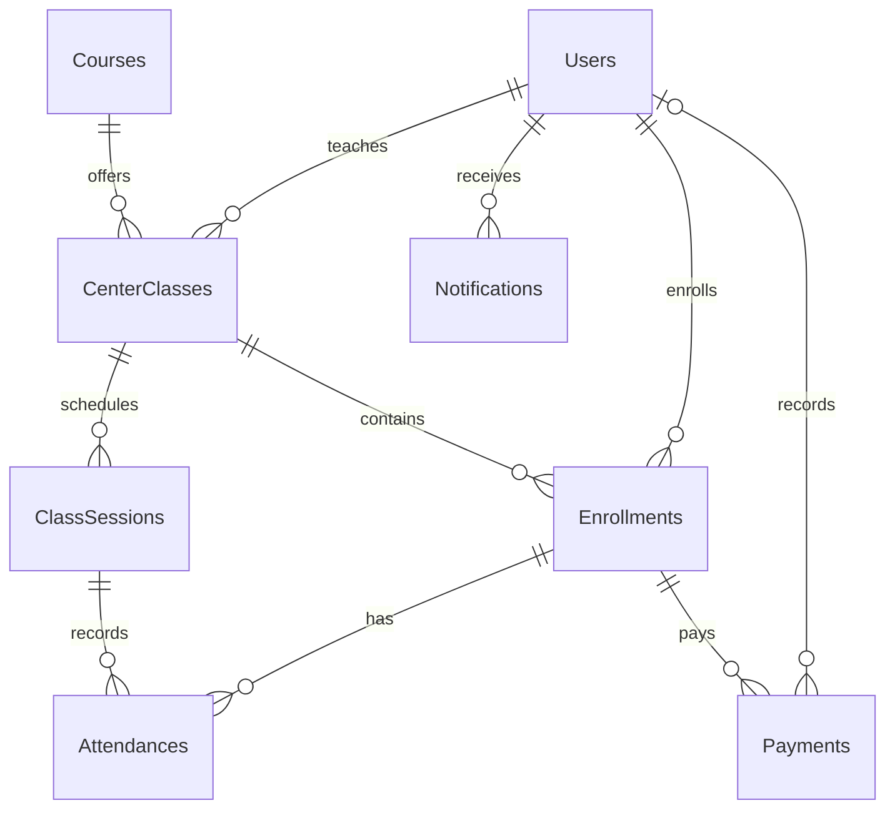

# Thiết kế và cách giải thích mã nguồn

## Kiến trúc

Browser → MVC Controller → service nghiệp vụ → Entity Framework 6 → SQL Server. Controller trả ViewModel hoặc entity cần thiết cho Razor View. CSS/JavaScript được lưu cục bộ trong Content/Scripts.

- Các file entity/enum riêng trong `Models/`: các entity, enum, thuộc tính kiểm tra và giá trị tính toán không lưu DB.
- `Models/CenterDb.cs`: DbContext, DbSet, tên bảng và độ chính xác decimal; không cascade delete dữ liệu lịch sử.
- `Models/ViewModels.cs`: dữ liệu cho form đăng nhập, đăng ký, điểm danh, bảng điểm và dashboard.
- `Controllers/`: nhận request, kiểm tra quyền, ModelState, gọi service và trả View/Redirect.
- `Services/EnrollmentService.cs`: cấp chỗ trong lớp, chống đăng ký trùng, quy trình trạng thái.
- `Services/PaymentService.cs`: giữ số tiền đang chờ, ngăn vượt công nợ, xác nhận giao dịch.
- `Services/NotificationService.cs`: tạo thông báo một lần theo người nhận/sự kiện.
- `Services/PasswordService.cs`: PBKDF2-SHA256, salt ngẫu nhiên, 100.000 vòng.
- `Services/ExcelExport.cs`: tạo gói OpenXML `.xlsx`, ô chuỗi không được coi là công thức.
- `Data/DemoInitializer.cs`: dữ liệu demo chạy đúng một lần khi database chưa tồn tại.
- `Global.asax.cs`: route, initializer, nạp lại vai trò và security stamp từ DB theo cookie.

## ERD

User dùng chung bảng và enum Role. CenterClass liên kết TeacherId tới User thuộc vai trò Teacher; Enrollment.StudentId phải thuộc Student. Kiểm tra vai trò được thực hiện ở máy chủ. Attendance kết nối một enrollment và một buổi thuộc cùng lớp; giáo viên chỉ thao tác danh sách đủ điều kiện của lớp được giao.

Unique indexes: Email; Code; StudentId + CenterClassId; ClassSessionId + EnrollmentId; ReceiptNo; RecipientKey + EventKey. Foreign keys ngăn tham chiếu mồ côi. CHECK constraints kiểm tra tiền dương, điểm 0–10, thời gian kết thúc sau bắt đầu, capacity dương.

## Quy tắc nghiệp vụ

1. Một học viên chỉ có một enrollment trong một lớp, kể cả đã Withdrawn. Muốn đăng ký lại liên hệ trung tâm; không tự tạo thêm bản ghi trùng.
2. Pending, Confirmed, Studying và Completed đều giữ chỗ trong lớp; Withdrawn giải phóng chỗ. Class.Status lưu Open/Closed; Full là trạng thái tính từ sĩ số nên tự cập nhật.
3. Đăng ký dùng transaction Serializable và UPDLOCK/HOLDLOCK trên lớp; unique index là lớp bảo vệ bổ sung. Không tin giá hoặc vai trò gửi từ form.
4. Chuyển trạng thái: Pending → Confirmed → Studying → Completed; từ ba trạng thái đầu có thể Withdrawn. Completed cần đủ điểm và đã công bố. Không tự chuyển trạng thái enrollment theo tiền vì trung tâm có thể cho đóng nhiều đợt.
5. AgreedFee chụp học phí tại lúc đăng ký. Đổi học phí khóa học không đổi công nợ cũ.
6. Paid mới tính vào số đã đóng và doanh thu. Pending giữ phần tiền tương ứng để tránh nhiều yêu cầu vượt công nợ. Rejected không tính tiền. Một giao dịch đã xử lý không được xác nhận lại. Không xóa/sửa tùy tiện giao dịch Paid; bản này chưa có quy trình hoàn tiền.
7. Học viên chỉ tự rút Pending chưa có Paid/Pending payment. Các trường hợp khác cần quản trị xử lý; lịch sử thanh toán vẫn giữ lại khi rút.
8. Giữa kỳ và cuối kỳ theo thang 10; tổng kết làm tròn hai chữ số: 40% + 60%; đạt từ 5.0. Lưu nháp ẩn điểm; công bố yêu cầu đủ hai điểm cho các hàng gửi lên.
9. Điểm danh chỉ sau thời điểm bắt đầu buổi, có Present/Absent/Late/Excused. Mặc định chưa chọn, tránh tự ghi có mặt cho mọi người.
10. Thêm buổi học kiểm tra giao nhau của khoảng thời gian: startA < endB và startB < endA. Hai buổi liền kề không bị coi là trùng.
11. Không xóa khóa đã có lớp, lớp có buổi/đăng ký hoặc buổi đã có điểm danh. Dùng ẩn/đóng để giữ lịch sử.
12. Thông báo được cập nhật theo truy cập học viên, Session giới hạn chu kỳ kiểm tra 5 phút. Trang thông báo có thể kiểm tra ngay; key duy nhất tránh lặp trong cùng sự kiện/ngày.

## Phân quyền

| Chức năng | Học viên | Giáo viên | Quản trị |
|---|---|---|---|
| Duyệt khóa | Có | Có | Có |
| Đăng ký | Chính mình | Không | Thay học viên |
| Hồ sơ/mật khẩu | Chính mình | Chính mình | Chính mình |
| Điểm danh/điểm | Xem bản thân | Lớp phụ trách | Mọi lớp |
| Học phí/biên lai | Bản thân | Không | Mọi học viên |
| Lịch tuần | Lớp Confirmed/Studying | Lớp được giao | Toàn trung tâm |
| Quản lý dữ liệu/xuất báo cáo | Không | Không | Có |

Mọi POST có AntiForgeryToken và ValidateAntiForgeryToken. GET không dùng để xóa hoặc xác nhận thanh toán. Cookie Forms Authentication chứa UserId và security stamp; vai trò lấy lại từ DB, không lấy từ form đăng ký. Người dùng tự đăng ký luôn là Student. Đổi mật khẩu/khóa/đổi vai trò làm mất hiệu lực cookie cũ.

## Liên hệ tài liệu đã học

- Lab 1 (16 trang): HTML semantic, CSS variables, Grid, responsive, JavaScript tương tác. Áp dụng ở layout/sidebar/cards/timetable và menu mobile.
- Lab 2 (11 trang): Model, Controller, routing, CRUD. Áp dụng ở Course, CenterClass, các controller và route mặc định Home/Index.
- Lab 3 (9 trang): Razor, Html helpers, biểu mẫu, anti-forgery. Áp dụng toàn bộ Views và form POST.
- Lab 4 (15 trang): EF, SQL Server, DbContext, ViewModel, partial view, filtering, pagination. Áp dụng CenterDb, `_CourseCards`, tìm kiếm/lọc/phân trang và dashboard.
- Nội dung Lab 6 được cung cấp (16 trang): Session, helper/service, ViewModel. Áp dụng Session cho thời điểm làm mới thông báo; enrollment và payment là dữ liệu bền vững nên phải lưu SQL, không lưu Session như giỏ hàng tạm.

Lab 5 không có trong file gửi nên không suy đoán nội dung. Mã mẫu lab là tham khảo kỹ thuật; đồ án có thêm phân quyền, validation phía server, transaction và POST chống CSRF.

## Giới hạn đã chủ động ghi rõ

Đây là ứng dụng đồ án để demo tại trung tâm. Chưa tích hợp cổng ngân hàng, email/SMS, reset mật khẩu qua email, file học liệu, chứng chỉ, homework, hoàn tiền hoặc audit log đầy đủ. Những mục này là mở rộng, không được giả lập bằng nút không hoạt động. Trước triển khai thực tế cần kiểm thử tải/đồng thời trên SQL thật, hoàn thiện vận hành/backup và bảo mật cấu hình IIS.

Phiên bản thư viện: [ASP.NET MVC 5.3.0](https://www.nuget.org/packages/Microsoft.AspNet.Mvc/5.3.0), [Entity Framework 6.5.1](https://www.nuget.org/packages/EntityFramework/6.5.1). Thông tin giấy phép của từng gói nằm trong thư mục packages tương ứng.
